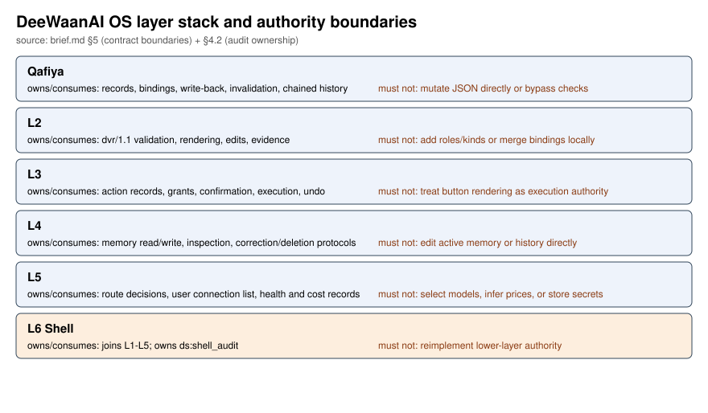
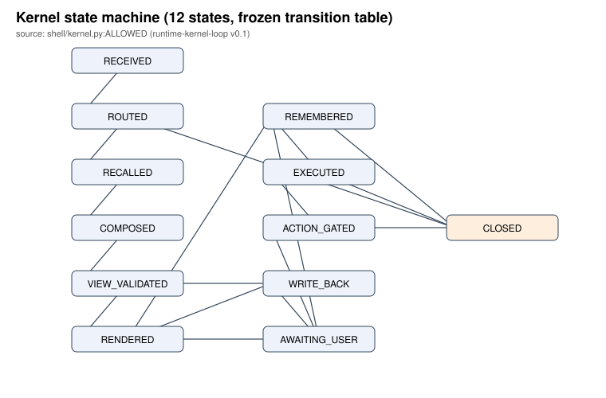
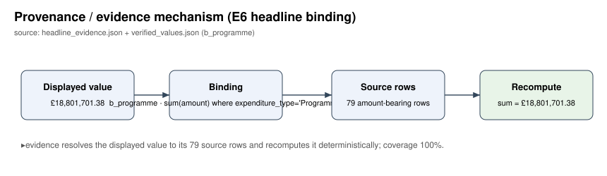
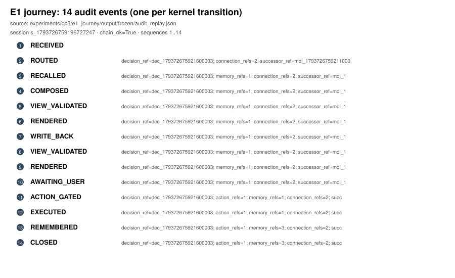
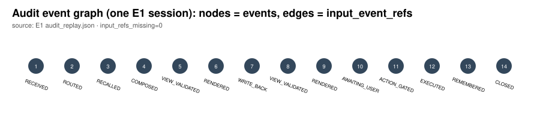
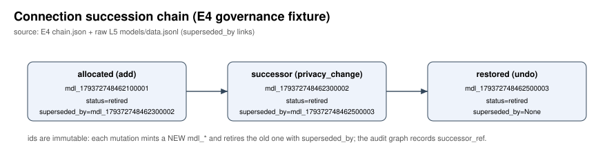
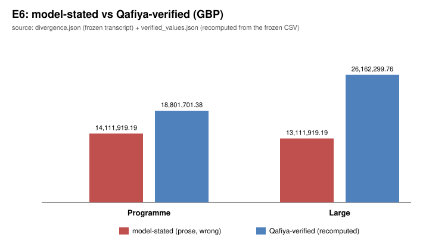

# The Agentic OS Shell: One Surface for Prompt, View, Action, and Audit (DeeWaanAI OS Layer 6)

**Author:** Youssef Hariri · DeeWaanAI · github.com/DeeWaanAI

## Abstract

An AI operating system is useful only if a person can move from intent to result without losing the trail. This paper presents the DeeWaanAI OS shell, the sixth layer, which joins five frozen lower layers into one user surface. The shell turns a prompt into a bound, interactive artifact and records the journey as an append-only, hash-chained audit graph. It adds no authority of its own: the data substrate owns mutation, the view renderer owns display, the action layer owns execution, the memory layer owns recall, and the model router owns model selection. The shell joins them and proves the join. We evaluate it with a functional-gate battery and six frozen experiments (E1–E6), including one on real open data with a real local model. The headline result concerns verification. On a real open dataset, a local language model stated two expenditure figures with confidence: £14,111,919.19 for total Programme expenditure and £13,111,919.19 for the largest supplier type. Both differ from the values the data bindings recompute deterministically from the frozen source, £18,801,701.38 and £26,162,299.76. The shell displayed the recomputed values, not the model's prose, and recorded the difference as evidence. The shell proves integration and audit. It does not prove that a model understood the user or that its prose is true; veracity is not claimed, and we report limitations and negative outcomes as first-class findings.

DOI: 10.5281/zenodo.24474610

## 1. Introduction

A chat window returns prose. The prose may cite a number, but the number carries no provenance. A user who acts on it cannot establish where it came from, whether it recomputes, or who approved the effect it implies. Generative interface toolkits return components, but a component that displays a value does not, by itself, carry the record that justifies the value. The result is a gap between what an AI system shows and what it can prove.

The DeeWaanAI OS layers below the shell each close part of that gap. Qafiya makes every displayed value resolve to a record through a binding [L1]. The view renderer makes generated interfaces auditable and editable over bound data [L2]. The action layer makes effects permissioned, provenance-carrying, and reversible [L3]. The memory layer makes recall a protocol with evidence rather than an edit [L4]. The model router makes model selection a recorded decision with declared and metered cost kept apart [L5]. None is a user surface on its own.

The shell is the surface that joins them. We do not claim that prompts, routers, or generated interfaces are new. We claim that one auditable journey across prompt, route, recall, view, action, and memory is new, and that it can be proven from frozen artifacts. The contributions are: a runtime kernel whose every transition emits one ordered audit event and whose illegal transitions fail loudly; an audit event graph (`ds:shell_audit`) that joins lower-layer records by reference without rewriting them; connection governance in which every mutation passes through the action layer and records its successor identifier; a route presentation that keeps declared cost and metered cost distinct; and an evaluation in which a real local model produced confident, incorrect figures on real open data while the binding layer recomputed the correct values.

Section 2 reviews related work and states the gap. Section 3 gives the system model, including the authority and threat models. Section 4 describes the design. Section 5 reports implementation metrics. Section 6 answers six research questions, one per experiment. Section 7 discusses the result and its generalization. Section 8 states the limitations in three buckets. Section 9 gives threats to validity. Section 10 states future work and scope. Section 11 concludes. Sections 12–14 cover reproducibility, data availability, and AI-usage disclosure.

## 2. Background and Related Work

We group the literature into eight themes. For each we state what it does, what it leaves unsolved, and how this work differs.

**LLM agent operating systems and runtimes.** AIOS frames the large language model as an operating-system kernel and agents as applications, with agent scheduling and tool management [1]. *From Commands to Prompts* places LLM-based semantic file access inside that agent OS [2]. These systems provide the intent surface and the runtime. They do not provide a proof substrate: a displayed value, an edit, an action, and a route do not retain explicit, recomputable provenance. The shell adopts the unified intent surface and differs in that every displayed value resolves to a record and every transition is auditable.

**Data provenance.** The W3C PROV family standardizes provenance interchange (PROV-O, PROV-DM) [3]. Buneman et al. characterize why-and-where provenance for data [4]. Content-authenticity efforts such as C2PA attach signed provenance to media [5]. These establish provenance as a first-class object, but they describe provenance after the fact and do not, by themselves, recompute a displayed value from its sources at render time. Qafiya bindings [L1] are per-value, carry a derivation, and are recomputed deterministically; a value whose derivation does not recompute is shown as unresolved rather than clean.

**Workflow and notebook reproducibility.** The Common Workflow Language specifies portable, provenance-aware workflows [6]. Taverna enacted bioinformatics workflows and captured provenance [7]; subsequent work analyzed why workflows break and how retrospective provenance combats it [8]. These make a computational workflow reproducible and its provenance queryable. The frozen-spine discipline here is stronger for the shell's own claims: every headline number is recomputed from raw artifacts by an independent script, and a number whose spine fails does not appear.

**Data lineage and catalogs.** DataHub manages collaborative data science and dataset versions [9]. OpenLineage standardizes lineage collection across jobs [10]. Amundsen catalogs datasets and dashboards [11]. These provide dataset-level and job-level lineage. They do not provide per-value provenance with deterministic recomputation at the point of display, which is what a generated view over bound data requires.

**Verifiable outputs and fact verification.** FEVER established large-scale fact extraction and verification [12]. Surveys of hallucination in natural language generation catalog detection and mitigation [13]. These approaches detect or score a claim after generation. The shell takes a different position: verify, do not trust. A data-derived number is recomputed from its source records by a binding; the model's prose is recorded but never rendered as a verified value. E6 demonstrates the difference on real data.

**Capability security and reversible actions.** Capability-based access control confines authority to unforgeable tokens [14]. Sagas model long-lived transactions with compensating sub-transactions [15]. The action layer [L3] combines these: an effect runs only under a grant (a capability) and confirmation, is classified by reversibility, and carries a compensating undo recipe. Connection mutations are compensable and supersede by succession rather than editing an immutable identifier in place.

**Generative UI and software-as-content.** Generative interfaces for language models produce UI just in time [16]; Lee proposes a working definition of generative UI design [17]; Peng et al. address efficient personalization of generative UI [18]; LEGOUI balances transparency and controllability with UI-DSL bricks [19]; and software-as-content treats dynamic applications as the human–agent interaction layer [20]. This work does not claim that generating UI is new. Its distinction is durable binding: the generated component resolves live data, writes through a governed edit path, and exposes evidence after the generating interaction has ended. Where the grammar has no authority-safe semantics (live service controls), a native surface remains and the ceiling is reported.

**AI documentation and audit norms.** Model Cards report model behavior and intended use [21]. Datasheets for Datasets document dataset provenance, composition, and collection [22]. These are documentation norms. The shell makes the equivalent of a model card and a datasheet a runtime property: the audit graph records every transition and reference, and the AI-usage disclosure (Section 14) records oversight episodes.

**The gap.** No prior system provides, for an LLM-agent shell, the combination of (a) per-value provenance with deterministic recomputation, (b) permissioned, reversible, provenance-carrying actions, (c) a replayable cross-layer audit graph, (d) model-agnostic local-first routing with declared-versus-metered cost separation, and (e) reported limits, joined in one surface. That join is the contribution.

## 3. System Model

### 3.1 Layers and frozen contracts

The OS has six layers. Each is simultaneously a software module and a paper. Layers integrate only through the frozen contract of the layers beneath them. The contract registry (`INTERFACES.md`) lists the frozen versions: Qafiya data model v1.1 and hash-chained history v1.3 [L1]; view grammar dvr/1.1 [L2]; action record v0.1 and connection-actions v0.2 [L3]; memory binding v1.0 [L4]; model routing policy v1.1 [L5]; and, registered during this work, runtime kernel loop v0.1 and shell audit event graph (`ds:shell_audit`) v0.1.



**Figure 1.** The layer stack and authority boundaries. Each row states what the shell consumes and what it must not do. Source: `brief.md` §5 (contract boundaries) and §4.2 (audit ownership); plotted values persisted at `paper/figures/values/fig1_architecture_values.json`.

### 3.2 Authority model

Authority stays below the display. The data substrate owns mutation; the view renderer owns display; the action layer owns execution; the memory layer owns recall; the model router owns selection. The shell owns exactly one dataset, `ds:shell_audit`, and one responsibility: joining the lower layers into one session and proving the join. A rendered button emits intent; it is not execution authority. The shell never edits a lower-layer dataset, never adds a view-grammar role, never selects a model, never infers a price, and never stores a secret.

### 3.3 Definitions

We use the following terms precisely and consistently.

A **binding** is a Qafiya §7 object that ties a displayed value to source records through a derivation drawn from a closed grammar (`FUNC(field) [where col='val']`, FUNC in sum, avg, count, min, max). A binding is recomputed by evaluating its derivation over the current records.

**Provenance coverage** is the fraction of data-bearing view nodes whose binding resolves and whose check state is pass. A node whose binding cannot resolve is rendered unresolved; coverage is then below 100 percent and the deficit is visible.

A **reversibility class** is one of exact, compensable, or irreversible. An exact action is reversed by restoring a recorded prior state. A compensable action is reversed by a compensating operation (a saga-style recipe [15]). An irreversible action has no recipe; its classification is the receipt.

A **successor by succession** is a new immutable identifier minted when a record's content changes, with the old identifier retired and pointing to the new one (`superseded_by`). Identifiers are never edited in place.

**Declared cost** is the router's calculation from user-declared connection prices and estimated tokens. **Metered cost** is a provider usage result after a call. The two are separate fields. An unmetered route records null, rendered as "not metered", never zero dollars. A local price of zero is a user declaration, not a measurement.

**Tamper-evident** means a hash-chained log that detects modification of an entry by recomputation. It is not tamper-proof against an actor who rewrites the store and recomputes every hash; that case is reported as uncatchable (Section 8, Bucket B).

### 3.4 Audit model

The shell owns `ds:shell_audit`, an append-only event graph with the full Qafiya §8 fileset (schema, data, chained history, bindings, superseded list). Each kernel transition appends exactly one `r_*` event carrying the session identifier, a monotonic per-session sequence, the state, causal `input_event_refs`, and the lower-layer references that apply (request, decision, view, edit, action, memory, connection, successor). Lower-layer records remain in their owning stores; the graph joins them by reference and never rewrites or merges their bindings. Replay resolves a session, verifies the chain, and reports unresolved references. The schema is frozen as `ds:shell_audit` v0.1.

### 3.5 Trust and threat model

The shell trusts the frozen contracts of the layers beneath it and the user's own declarations (connection locus, privacy class, declared prices). It does not trust model prose: no state transition rests on a model's claim that it occurred. The adversary model for the audit log is accidental or naive modification, which the chain detects; a determined insider with full store access who rewrites the log and recomputes every hash is outside what the chain alone can stop, and we propose external anchoring as an operator-deployed recipe rather than claiming to solve it (Section 8, Bucket B). Secrets never enter a record: a connection carries the name of an environment variable, never its value, and both the action layer and the router refuse a value independently.

## 4. Design

### 4.1 Kernel

The runtime kernel has twelve named states and a frozen transition table. A journey moves RECEIVED → ROUTED → RECALLED → COMPOSED → VIEW_VALIDATED → RENDERED, then branches to WRITE_BACK (a cell edit), to AWAITING_USER → ACTION_GATED → EXECUTED (an approved effect), or to REMEMBERED, and finally to CLOSED. Refusal paths are first-class: ROUTED → CLOSED (a typed routing refusal) and ACTION_GATED → CLOSED (a refused or rejected action) both close a complete, auditable journey with no execution effect. Every allowed transition appends exactly one ordered audit event. An illegal transition raises and writes nothing.



**Figure 2.** The kernel state machine: twelve states and eighteen allowed edges, generated programmatically from the frozen transition table. Source: `shell/kernel.py:ALLOWED` (runtime-kernel-loop v0.1); plotted values persisted at `paper/figures/values/fig2_kernel_values.json`.

### 4.2 Audit event graph

The event schema is the frozen `ds:shell_audit` v0.1 contract. Two disclosure fields are load-bearing. `declared_cost_usd` and `actual_metered_cost_usd` are separate; the second is null when no provider meter exists. `content_policy` records whether prompt and response content may be stored; secrets are never stored. `successor_ref` records the new identifier whenever a connection mutation superseded, so the graph never assumes an identifier is stable.

### 4.3 Connection governance through the action layer

Live connection controls have no dvr/1.1 role, so the connection manager is a native settings surface backed by the router. Read-only listing and measured status remain router operations. Every mutating operation (add, retire, privacy change) is submitted as intent to the action layer, whose gate and confirmation govern the effect and produce the `a_*` record that joins the audit graph. The router's public connection operations are handed to the action engine; the shell never calls them directly. Retire and privacy change are compensable and supersede to a new identifier; the successor is read from the router's accessors and recorded.

### 4.4 View and evidence mechanism

The view renderer validates a dvr/1.1 view and renders each data-bearing node through its binding. A value node exposes an evidence affordance that resolves the binding to its source rows and recomputes the value. An edit produces an edit binding, writes through the substrate, invalidates dependents to pending, and re-proves before the value is shown as clean.



**Figure 3.** The provenance and evidence mechanism on the E6 headline binding: a displayed value resolves through binding `b_programme` to its 79 amount-bearing source rows and recomputes to £18,801,701.38. Source: `experiments/cp3/e6_realistic_demo/output/frozen/headline_evidence.json` and `verified_values.json`; plotted values persisted at `paper/figures/values/fig5_evidence_values.json`.

## 5. Implementation

The shell is implemented in Python, pinned to CPython 3.12 (the interpreter the frozen pre-flight requires; the bootstrap exits loudly on an older interpreter). It imports the lower layers only through frozen contracts. At freeze time the exact imported action-layer and router source was copied into a vendored snapshot under the shell, with a per-file sha256 list verified on every import; drift fails loudly rather than running against a changed layer. The live router datasets the experiments read are pinned by sha256 in the master manifest as a drift check. Table 1 reports the real metrics, recomputed from the frozen tree.

**Table 1. Implementation metrics** (source: `experiments/cp3/implementation_metrics.json`, recomputed from the frozen tree; LOC counts non-empty physical lines).

| Component | Files | LOC |
|---|---|---|
| Shell modules (`shell/*.py`) | 10 | 1,054 |
| Experiments, top level (journey, spines, gates, fake transport) | 5 | 2,228 |
| Experiments, CP3 (E1–E6, common, manifest, master spine) | 18 | 3,068 |
| Pre-flight (frozen cross-layer demo + spine) | 3 | 327 |
| **Shell-owned total** | **36** | **6,677** |
| Vendored snapshot (L3 + L5, read-only) | 29 | 3,657 |
| **Total Python** | **65** | **10,334** |

The vendored snapshot pins 31 files (the 29 Python modules plus the tokenizer data the router's token counter requires for the real local connection). The master manifest pins 61 experiment and snapshot files plus 9 live router-dataset files. Dependencies are the standard library plus the frozen lower-layer packages; the token counter uses the `tokenizers` package already present under the pinned interpreter.

## 6. Evaluation

The evaluation is framed by six research questions, one per experiment. Each is answered with evidence, a figure, and a real example quoted verbatim from a frozen artifact and cited to its file path. The functional-gate battery (F1–F8) precedes the experiments and is green; the experiments are the frozen, spine-verified results.

### RQ1. Can the shell join all five layers into one auditable journey? (E1)

Yes. E1 carries one prompt across all five layers and logs it as bound records. The prompt, verbatim from `experiments/e2e_journey.py`, is:

> "Change the 9 August Q3 food expense to 956.14, create an audit note, and remember what happened."

The kernel walks all twelve states and writes fourteen audit events with a complete, monotonic sequence and a verifying chain. The edit changes record `r_051` to 956.14; the quarter total moves from 10346.71 to 10481.96, and the spine recomputes 10481.96 from the raw records (`experiments/cp3/e1_journey/output/spine-result.json`). The claim resolves to its 21 source rows through the evidence panel. A connection is declared and its privacy class changed; because identifiers are immutable, the change is applied by succession, and the audit graph records the successor identifier on every subsequent event. An integration that assumes identifier stability breaks this silently; the spine confirms the chain links from the raw records.

One real audit event, verbatim from `experiments/cp3/e1_journey/output/frozen/audit_replay.json` (the RECEIVED event, truncated to its identifying fields):

```json
{"id": "r_17937267592082f6d59", "session_id": "s_1793726759196727247",
 "sequence": 1, "state": "RECEIVED", "spec_version": "0.1", "status": "active",
 "request_ref": "req_1793726759196a126f2", "decision_ref": null,
 "input_event_refs": [], "successor_ref": null,
 "declared_cost_usd": null, "actual_metered_cost_usd": null,
 "content_policy": {"store_prompt_content": "never", "store_response_content": "never"},
 "notes": "prompt received: req_1793726759196a126f2"}
```



**Figure 4.** The E1 journey: fourteen audit events, one per kernel transition, with the lower-layer references each carries. Source: `experiments/cp3/e1_journey/output/frozen/audit_replay.json`; plotted values persisted at `paper/figures/values/fig3_e1_timeline_values.json`.



**Figure 5.** The audit event graph for the E1 session: nodes are events ordered by sequence, edges are `input_event_refs`. Zero references are unresolved. Source: `experiments/cp3/e1_journey/output/frozen/audit_replay.json`; plotted values persisted at `paper/figures/values/fig7_event_graph_values.json`.

### RQ2. Are negative outcomes as auditable as successes? (E2)

Yes. E2 walks five negative variants, each a purpose-built frozen fixture. The typed outcomes are recorded verbatim. The failure variant (a delete on a missing file) produces, from `experiments/cp3/e2_auditability/output/frozen/failure/action_record.json`:

```json
{"status": "refused", "reason": "preconditions_failed:target_exists"}
```

The reject variant records an intent without execution; from `.../reject/reject_intent.json`:

```json
{"ok": true, "detail": "intent recorded: reject (no execution)"}
```

and the audit graph for that session contains no EXECUTED event, and the previously approved file is byte-identical afterward. The refusal variant (a grant that omits the target) writes no file. The unresolved variant renders a quarantined binding as UNRESOLVED. Each variant replays with a complete sequence, zero unresolved references, and a verifying chain.

### RQ3. Is routing cost presented without conflating declared and metered? (E3)

Yes. E3 audits three cases. The dry-run case is planned and unmetered; from `experiments/cp3/e3_routing_cost/output/frozen/dry_run_planned/presentation.json`:

```json
{"outcome": "planned", "metered": false, "declared_cost_usd": 0.0,
 "actual_metered_cost_usd": null}
```

The fake-transport case is answered and metered, and every attempt carries the simulated label; from `.../fake_answered_metered/decision_record.json`, one attempt:

```json
{"model_ref": "mdl_179372735277000004", "meter": "simulated_local_fake",
 "tokens_in": 18, "tokens_out": 24, "actual_cost_usd": 0.0, "est_cost_usd": 0.0}
```

The simulated number is never presented as a provider meter. The all-failed case is refused with reason `all_connections_failed` and no chosen connection. Declared and actual cost stay distinct in all three.

### RQ4. Are connection mutations governed, reversible, and secret-free? (E4)

Yes. E4 exercises governance on a local fake endpoint that is declared but never called. The full succession chain runs through the action layer. The real identifiers, from `experiments/cp3/e4_connection_governance/output/frozen/governance_chain/chain.json`, are `mdl_179372748462100001` (allocated by add), `mdl_179372748462300002` (successor minted by privacy change), and `mdl_179372748462500003` (restored by undo of the privacy change); each is retired at the end of the chain with `superseded_by` pointing to the next. A rejected operation under a grant that omits `connection.retire` produces, from `.../rejected_operation/rejected.json`:

```json
{"status": "refused", "reason": "action_type_not_granted:connection.retire"}
```

and the active connection list is byte-identical before and after. A connection whose key environment variable is absent stays active with the typed problem `missing_env:L6_SHELL_E4_BROKEN_KEY_ABSENT` (from `.../no_implicit_retirement/broken.json`); the shell never retires a broken entry implicitly. No secret value appears in any record; only the environment-variable name crosses the boundary.



**Figure 6.** The connection succession chain: allocated → successor → restored, each retired with `superseded_by` pointing to the next. Identifiers are immutable; a mutation mints a new `mdl_*`. Source: `experiments/cp3/e4_connection_governance/output/frozen/governance_chain/chain.json` and the raw L5 `models/data.jsonl`; plotted values persisted at `paper/figures/values/fig6_succession_values.json`.

### RQ5. What can the shell provably not do? (E5)

E5 reports the limits as results, measured where a machine-checkable proxy exists. The expressibility ceiling is five of the six original screen classes, and it is enforced: the validator rejects an invented `service_control` role rather than accepting it. A naive tamper of a chained entry is detected by chain verification and by manifest hashing. A missing dataset raises a typed `StoreError` rather than passing silently. Eight limit classes are reported; one (the trust-user mode recording a public class by construction rather than by computation) is demonstrated from a raw decision record, and the rest are stated as boundaries. The full-store-rewrite case is reported as uncatchable, not as caught. Section 8 groups these limits by responsibility.

### RQ6. Does verification hold on real data with a real model, and does it catch model error? (E6)

Yes, and it catches the error. E6 runs the shell over a real open dataset and a real local model, with every model output frozen.

The data is the UK Cabinet Office "Expenditure over £25,000" return for February 2013, published on gov.uk under the Open Government Licence v3.0. The frozen file has 143 source records, of which 129 carry an amount; 14 are entirely empty rows that we report and keep in place rather than drop. Three source data-quality facts are reported verbatim and none is silently fixed: the 14 empty rows, two spellings of one supplier-type category ("Gov Dept" and "Government Department"), and one negative amount (a credit of −115,912.64). The shell builds nine Qafiya bindings over the amount column. The headline binding recomputes total Programme expenditure as 18,801,701.38, and its evidence panel resolves that figure to its 79 amount-bearing source rows.

The model is llama3.1:8b-instruct-q4_K_M, run locally through ollama on the loopback interface, with greedy decoding at temperature zero. It fills only the COMPOSE step. A guard that permits loopback and blocks everything else proves the run touched only port 11434 and made zero non-loopback calls. The prompt and the response are frozen. The response, verbatim from `experiments/cp3/e6_realistic_demo/output/frozen/transcript_main.json`, is:

> "The total Programme expenditure is £14,111,919.19. The supplier type that received the largest total spend is Large, with a total of £13,111,919.19."

Both figures differ from the verified values. The verified Programme total is 18,801,701.38 and the verified Large-supplier total is 26,162,299.76, recomputed deterministically from the frozen file by the spine's own independent parser (`experiments/cp3/e6_realistic_demo/output/spine-result.json`). The shell rendered the verified values, never the model's prose, and recorded the difference as evidence. The model named the correct category (Large) and the wrong magnitude; the binding recomputes the magnitude regardless of the prose.



**Figure 7.** The headline result: model-stated versus Qafiya-verified figures for Programme (£14,111,919.19 stated vs £18,801,701.38 verified) and Large (£13,111,919.19 stated vs £26,162,299.76 verified). The shell renders the verified bars. Source: `experiments/cp3/e6_realistic_demo/output/frozen/divergence.json` and `verified_values.json`; plotted values persisted at `paper/figures/values/fig4_divergence_values.json`.

Two further properties are built into the experiment. Cost: the local connection declares a price of zero, which is a user declaration, and the actual metered cost is null because a local model has no provider billing meter; the router's own arithmetic value (0.0) is recorded alongside the presented null, with the reason. Stability: the same prompt was run five times under greedy decoding, and all five responses were byte-identical (one distinct response, mean token-position agreement 1.0). Every auditability claim is invariant to the prose, because the claims are computed over the frozen data and the audit graph, not over the model's wording.

**Table 2. Comparison with related systems across the axes the gap identifies.** A check means the property is provided and, for this work, demonstrated by a frozen experiment cited in the cell; a dash means it is not provided. Sources for this work's column: E1/E6 (per-value provenance and recompute), E4/F4 (gated reversible actions), E1/F7 (replayable cross-layer audit), E3 (declared-versus-metered), E5 (reported limits).

| Axis | AIOS [1] | Generative-UI toolkit [16] | Lineage catalog [9,10] | This work |
|---|---|---|---|---|
| Per-value provenance with recompute | – | – | dataset/job-level | ✓ (E1, E6) |
| Permissioned, reversible, provenance-carrying actions | – | – | – | ✓ (E4) |
| Replayable cross-layer audit graph | – | – | partial (lineage) | ✓ (E1, F7) |
| Model-agnostic local-first routing | partial | – | – | ✓ (E3) |
| Declared-versus-metered cost separation | – | – | – | ✓ (E3) |
| Reported limits (first-class negatives) | – | – | – | ✓ (E5, E6) |

## 7. Discussion

The result generalizes as a demonstration, not as a population claim. On one real open dataset, with one local model, on one host, a confident model answer diverged from the recomputed value, and the binding layer produced the correct value regardless. The positioning follows: the shell is the accountability layer under a user-chosen model. It makes actions auditable and data-derived numbers verifiable despite the model being fallible. It does not vouch for the truth of model prose; veracity is not claimed. The divergence in E6 is the intended behavior of "verify, do not trust", not a failure to be hidden.

The join is the contribution. Each lower layer was already verified by its own paper and spine; the shell adds the cross-layer journey, the audit graph that joins the records, and the demonstration that the join holds on real data with a real model. Broader workloads, more models, and more datasets are future work.

## 8. Limitations

We report limitations and negative outcomes as first-class findings. E5 reports eight limits. They are not all the same kind of thing, and presenting them as one flat list of system failures would misattribute responsibility, so we group them into three buckets.

**Bucket A — inherent to working with AI (limits 1, 2, 3, 5, 6).** The shell cannot prove that the model understood the user's intent, that generated prose is true, that a routed answer is optimal, that the normalization of an intent was the correct reading (the action gate checks the normalized action, not the interpretation behind it), or that information already absorbed into a model's weights can be retracted (deletion removes our records; it cannot un-train a provider). These are properties of any AI system, not failures of the shell. The user owns their model choice. The shell's contribution is to make actions auditable and data-numbers verifiable despite that fallibility. E6 is the evidence.

**Bucket B — we provide the mechanism; the operator owns the configuration and the consequence (limits 4 and 7).** These are not dead ends, and we do not claim to solve them. For sensitivity classification (limit 4), the router's default trust-user mode does not classify data sensitivity; this is a deliberate, non-paternalistic choice for a local-first system, and it records the class as public by construction and says so. An optional rules-based sensitivity classifier exists in the router, and the operator decides whether to enable it. For a deployment that carries personal data, the operator should either enable that classifier or keep private data on local connections — their duty, for example under LGPD. For tamper resistance (limit 7), the hash chain is tamper-evident: E5 demonstrates detection of a naive edit. It is not tamper-proof against an insider with full store access who rewrites everything and recomputes every hash; we report that full-rewrite case as uncatchable. We propose external anchoring as a recipe the operator can run — publish a periodic chain hash, or commit it to write-once storage — but each operator must set it up and own it. Stronger assurance is the operator's to deploy; it is not our guarantee.

Concretely, the uncatchable class is this: if an actor rewrites `datasets/shell_audit/data.jsonl` and then recomputes every `prev_hash` and `entry_hash` in `history.jsonl`, `chain.verify` returns true. E5 demonstrates that a naive edit (changing a state without recomputing hashes) is detected; it does not claim to detect a full rewrite. The mitigation is external anchoring, which the operator deploys.

**Bucket C — scope boundaries (limit 8, and the expressibility ceiling).** Closed graphical applications sit outside routing, and there are two distinct doors. The outbound door is theirs: for the shell to route work to an external application or to audit it, that application must expose an API or endpoint; a GUI-only application with no supported interface is outside the governed surface, and we do not perform GUI automation, by design. The inbound door is ours: for a real deployment the shell would expose an API so an external application can call it automatically. That inbound API is future work for a server phase and is not built; the shell today is a single-user prototype (Section 10). The expressibility ceiling is five of the six original screen classes. Live connection controls have no dvr/1.1 role, so they remain a native settings surface. This is a documented workaround, not evidence that the grammar expresses live service controls, and the ceiling is enforced: the validator rejects an invented `service_control` role rather than accepting it.

**Table 3. The eight limits by bucket** (source: `experiments/cp3/e5_shell_limits/inputs/spec.json`, the frozen E5 limit classes; bucket assignment per `paper-limits-framing-04-nov-2026-2058.md`).

| # | Limit | Bucket | Disposition |
|---|---|---|---|
| 1 | Cannot prove the model understood intent | A | inherent to AI; user owns model choice |
| 2 | Cannot prove generated prose is true | A | inherent to AI; veracity not claimed |
| 3 | Cannot prove a routed answer is optimal | A | inherent to AI |
| 4 | Trust-user mode does not classify sensitivity | B | optional rules-based classifier; operator decides |
| 5 | Cannot prove normalization was the correct reading | A | gate checks the normalized action, not the reading |
| 6 | Cannot retract information absorbed into weights | A | deletion removes records, cannot un-train |
| 7 | Chain is tamper-evident, not tamper-proof | B | external-anchoring recipe; operator deploys |
| 8 | Closed GUI apps outside routing | C | outbound door (theirs); inbound API is future work |

## 9. Threats to Validity

**External validity.** The evaluation uses one real open dataset (UK Cabinet Office February 2013), one local model (llama3.1:8b-instruct-q4_K_M, q4_K_M, greedy), and one host (a local Apple-silicon machine). E6 is a demonstration that verification holds on real data with a real model and catches model error; it is not evidence about model quality across datasets, models, or hosts. The offline core (E1–E5) is deterministic and reproducible, but it exercises one journey shape and one gate battery.

**Internal validity.** E6 is frozen from one greedy run for the journey plus k=5 greedy runs for stability; all five stability responses were byte-identical, so the measured token-level variance is zero on this host and this decoding. Greedy determinism is a property of this runtime and hardware, not a general guarantee. The auditability claims are invariant to the prose by construction: they are computed over the frozen data and the audit graph, never over the model's wording, so a claim that would change with the prose is excluded from the verified set. The divergence verdict depends on a prose-figure extractor; the extractor associates each figure with the category noun the prose attached it to, and the spine re-implements it independently, so a mis-assignment is caught (it was, and was fixed; Section 14).

**Construct validity.** "Provenance coverage" and "verifiable" are defined operationally: a value is verifiable when its binding resolves to source rows and its derivation recomputes to the displayed value within tolerance. No claim of semantic correctness is made — a binding can recompute exactly and still answer a question the user did not ask. "Tamper-evident" means detection of entry modification by hash recomputation, not resistance to a full-store rewrite. "Auditable" means the event graph replays with complete sequences, resolved references, and a verifying chain.

**Conclusion validity.** The join is demonstrated on one end-to-end journey, one functional-gate battery (8 of 8), and six frozen experiments, each recomputed by an independent spine from raw artifacts. The claim is bounded accordingly: the shell can join the layers and prove the join on the evaluated workloads. Generalization to broader workloads, concurrent users, and deployed settings is future work.

## 10. Future Work and Scope

The shell today is a single-user prototype. Three things are explicitly out of current scope (`brief.md` §10) and belong to a later server phase. First, the inbound API: an interface so an external application can call the shell automatically — the inbound door named in Section 8. It is not built, and no claim in this paper depends on it. Second, multi-user operation: concurrent sessions, per-user authority, and a shared audit graph are out of scope; the current audit graph is per-session by construction and assumes one shell process per journey store. Third, deployment: packaging onto a Linux distribution, hosting, and provider onboarding are excluded by the brief. The contribution proven here is the single-user auditable join across prompt, route, recall, view, action, and memory.

## 11. Conclusion

The DeeWaanAI OS shell joins five frozen layers into one user surface and proves the join from frozen artifacts. A runtime kernel emits one ordered audit event per transition and fails loudly on an illegal one. An append-only, hash-chained audit graph joins lower-layer records by reference and replays. Connection mutations pass through the action layer and record their successor identifiers. Routing keeps declared and metered cost distinct. On real open data with a real local model, the binding layer recomputed the correct expenditure values while the model stated incorrect ones, and the shell displayed the recomputed values and recorded the difference. The shell proves integration and audit. It does not prove that a model understood the user or that its prose is true. We report limitations and negative outcomes as first-class findings, and we state what the system provably cannot do.

## 12. Reproducibility

The shell imports the lower layers only through frozen contracts. The vendored snapshot of the imported action-layer and router source carries a per-file sha256 list verified on every import; drift fails loudly. The live router datasets the experiments read are pinned by sha256 in the master manifest. The interpreter is pinned to CPython 3.12. Each experiment freezes its inputs before it runs, and an independent spine recomputes every headline number from the raw artifacts; if a spine fails, the number does not appear. E6 needs no model and no network to re-verify: its spine reads the frozen transcript. The master spine runs all six experiment spines and three regressions — the pre-flight (12 of 12 checks, quarter total 10481.96), the integration journey (36 checks), and the functional-gate battery (8 of 8 gates) — and all pass. Every figure is generated by `paper/figures/make_figures.py`, which reads only frozen artifacts and persists each figure's plotted values under `paper/figures/values/`; the SVG is the source of truth and PDF export happens at the Overleaf build step.

## 13. Data Availability

The E6 dataset is the UK Cabinet Office "Expenditure over £25,000", February 2013, downloaded from gov.uk on 3 Nov 2026 and frozen verbatim under the experiment inputs with its sha256 recorded in the manifest. It is used under the Open Government Licence v3.0. Required attribution, carried verbatim in the frozen manifest and here:

> Contains public sector information licensed under the Open Government Licence v3.0.

Licence: https://www.nationalarchives.gov.uk/doc/open-government-licence/version/3/. The data is non-PII: payments to organisations only, with no private-individual data and none added. The frozen model transcripts, the vendored layer snapshot, the figure scripts and persisted values, and every spine are deposited with the artifact under the owner's Zenodo (DOI 10.5281/zenodo.24474610) and in the companion repository https://github.com/DeeWaanAI/shell. Code licence: AGPL-3.0 (GNU Affero General Public License v3.0), commercial dual-licence intended. The repository carries the shell source, the frozen experiment inputs and outputs, the pre-flight manifest and spines, and the claim-to-evidence map, so every headline number can be recomputed from a fresh clone.

## 14. AI-Usage Disclosure

The shell's lower layers and this capstone were built with AI agents under explicit human oversight. The owner authored and approved every brief, contract, and checkpoint. No model made an unsupervised design decision. Each checkpoint was verified by an independent monitor agent that re-ran the spines rather than trusting the builder's summary. Two oversight episodes are recorded because they are the evidence that the enforcement works. In the first, a divergence artifact mis-assigned the model's Large-supplier figure by picking the nearest number rather than the number the prose attached to the category; the monitor caught it, the extraction was fixed to associate each figure with its category noun, and the corrected value (13,111,919.19) is what the spine now recomputes. In the second, the record count was stated loosely as "129 data rows"; the monitor required the precise statement (143 source records, 129 amount-bearing, 14 empty rows reported and not dropped), and every label was corrected. The claim-to-evidence map at `paper/claim_map/` is the standing enforcement artifact, and `verify_two_way.py` is its executable gate.

## References

External references are numbered in order of appearance; each was verified to resolve via the arXiv API, Crossref, or an HTTP check on 5 Nov 2026, and the evidence is recorded in `paper/claim_map/references-verified.json` (22 verified, 0 unresolved). Style: ACM numbered.

[1] K. Mei, X. Zhu, W. Xu, et al. 2024. AIOS: LLM Agent Operating System. arXiv:2403.16971.

[2] Z. Shi, K. Mei, M. Jin, et al. 2024. From Commands to Prompts: LLM-based Semantic File System for AIOS. arXiv:2410.11843.

[3] W3C. PROV-O: The PROV Ontology. W3C Recommendation. https://www.w3.org/TR/prov-o/.

[4] P. Buneman, S. Khanna, and W.-C. Tan. 2001. Why and Where: A Characterization of Data Provenance. ICDT 2001. https://doi.org/10.1007/3-540-44503-X_20.

[5] C2PA. Coalition for Content Provenance and Authenticity specification. https://c2pa.org/.

[6] Common Workflow Language specification. https://www.commonwl.org/.

[7] T. Oinn, M. Addis, J. Ferris, et al. 2004. Taverna: a tool for the composition and enactment of bioinformatics workflows. Bioinformatics 20(17). https://doi.org/10.1093/bioinformatics/bth361.

[8] 2012. Why workflows break — Understanding and combating failures. IEEE eScience 2012. https://doi.org/10.1109/escience.2012.6404482.

[9] A. Kandasamy, et al. 2014. DataHub: Collaborative Data Science & Dataset Version Management at Scale. arXiv:1409.0798.

[10] OpenLineage specification. https://openlineage.io/.

[11] Amundsen data catalog. https://github.com/amundsen-io/amundsen.

[12] J. Thorne, A. Vlachos, C. Koch, et al. 2018. FEVER: a large-scale dataset for Fact Extraction and VERification. arXiv:1803.05355.

[13] Z. Ji, N. Lee, R. Frieske, et al. 2022. Survey of Hallucination in Natural Language Generation. arXiv:2202.03629.

[14] J. B. Dennis and E. C. Van Horn. 1966. Programming semantics for multiprogrammed computations. CACM 9(3). https://doi.org/10.1145/365230.365252.

[15] H. Garcia-Molina and K. Salem. 1987. Sagas. SIGMOD 1987. https://doi.org/10.1145/38714.38742.

[16] J. Chen, Y. Zhang, Y. Zhang, et al. 2025. Generative Interfaces for Language Models. arXiv:2508.19227.

[17] K. Lee. 2025. Towards a Working Definition of Designing Generative User Interfaces. ACM. https://doi.org/10.1145/3715668.3736365.

[18] Y.-H. Peng, J. P. Bigham, and J. Wu. 2026. Efficient Personalization of Generative User Interfaces. arXiv:2604.09876.

[19] Y. Zhou, M. Yuan, H. Xu, et al. 2026. LEGOUI: Designing with UI-DSL Bricks to Balance Transparency and Controllability. arXiv:2608.04293.

[20] M. Xie and Y. Xie. 2026. Software as Content: Dynamic Applications as the Human-Agent Interaction Layer. arXiv:2603.21334.

[21] M. Mitchell, S. Wu, A. Zaldivar, et al. 2019. Model Cards for Model Reporting. FAT* 2019. https://doi.org/10.1145/3287560.3287596.

[22] T. Gebru, J. Morgenstern, B. Vecchione, et al. 2021. Datasheets for Datasets. CACM 64(12). https://doi.org/10.1145/3458723.

**Companion layer papers (DeeWaanAI OS, same author; DOI placeholder until published).**

[L1] Y. Hariri. Qafiya: A Provenance-First Data Model for Trustworthy AI-Generated Views over Personal Data. Layer 1 (the data-map lineage paper).

[L2] Y. Hariri. Verifiable Generative Views: Rendering, Editing, and Auditing LLM-Generated Interfaces over Bound Data. Layer 2.

[L3] Y. Hariri. Reversible Agency: A Permissioned, Provenance-Carrying Action Layer for LLM Operating Systems. Layer 3.

[L4] Y. Hariri. Verifiable Memory: Sessions, Preferences, and History as Provenance-Carrying Records for AI Agents. Layer 4.

[L5] Y. Hariri. Where Should This Query Run? Cost-, Privacy-, and Verifiability-Aware Model Routing for Personal AI Systems. Layer 5.

---

*Every quantitative statement, figure value, and table cell in this paper is linked to a frozen artifact in `paper/claim_map/paper-claims.json` and re-verified against raw data by `paper/claim_map/verify_two_way.py` (exit 0). Every external citation is verified to resolve in `paper/claim_map/references-verified.json`. A number that traces to no frozen artifact does not appear.*
